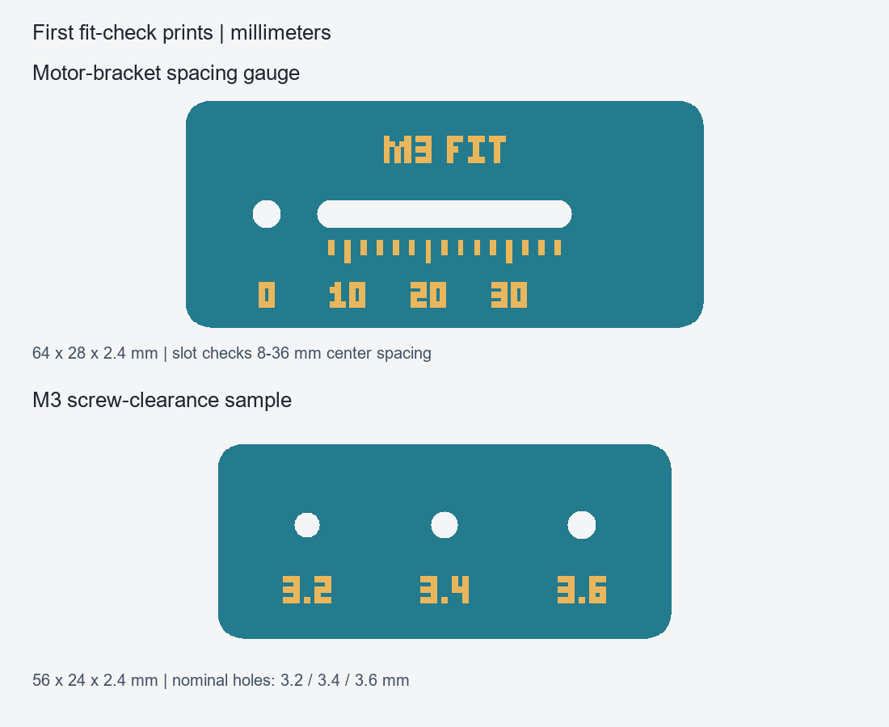

# FNK0053 Modular Rover

A work-in-progress 3D-printed chassis for the **Freenove FNK0053 4WD ESP32 rover**, with replaceable protective parts and mounting points for future accessories.

The longer-term goal is a mobile robot that can see, respond, and express itself. The first milestone is a durable, serviceable mobile base that reuses the existing kit hardware.

**Current status: revision B, based on Freenove's STEP measurements. The full chassis is experimental and has not been physically fit-checked.** Kit dimensions and mounting locations now come from CAD; the new frame, fasteners, head support and audio mounts still need physical checks. The small fit coupons are measuring tools, not motor mounts.


An optional **removable cage** now adds two side hoops and two upper crossbars. Four dedicated base bolts release the complete cage. See the [cage parts and assembly guide](docs/removable-cage.md). It requires the matching carrier with mounting pads; fit, head movement and impact strength remain unverified.

## Software checkpoint - 2026-10-29

- [Rover firmware fork](https://github.com/kagedws6/Freenove_4WD_Car_Kit_for_ESP32): command expiry, bounded parsing, PWM limits and ramps, and local Wi-Fi setup are built and flashed. Host tests and network rejection/reconnection checks passed with zero commanded motor output; a camera frame decoded successfully. See the [control notes](https://github.com/kagedws6/Freenove_4WD_Car_Kit_for_ESP32/blob/master/docs/modular-rover-control.md).
- [Voice firmware fork](https://github.com/kagedws6/xiaozhi-esp32): the unchanged Waveshare audio-board baseline is built and flashed; Wi-Fi reconnect, activation, wake word and one spoken exchange are confirmed. See the [baseline notes](https://github.com/kagedws6/xiaozhi-esp32/blob/main/docs/rover-voice-baseline.md).

Physical driving and the voice-to-rover bridge remain pending. Private firmware backups, credentials, serial logs and camera captures are not published.

## Revision B

- Measured 233.31 x 120.34 x 1.6 mm PCB envelope and 64.6 mm wheels.
- Stock wheel positions retained, approximately 148.8 mm tire-to-tire width.
- Narrow-waist 244 x 132 mm carrier with measured 8 mm motor-bracket screw pairs.
- PCB raised 10.7 mm so the carrier supports the motors independently.
- Stock line-sensor elevation and 28 mm sensor standoffs retained.
- Removable 110 x 120 mm accessory deck and separate bumper parts.
- Tire-envelope clearance exceeds 3.1 mm; the pan-servo frame opening has 2 mm nominal clearance.

Start with the [fixed 8 mm bracket fit coupon](fit-checks/motor-bracket-8mm-fit.stl). See [revision B engineering notes](docs/revision-b.md) for assumptions and checks. [Experimental frame/deck STLs](experimental/) are available for inspection and slicing, not as validated final parts.

## What is here

- [Editable chassis concept](rover-concept.scad): reinforced open frame, replaceable bumpers, removable deck and an audio adapter.
- [Interactive concept preview](docs/index.html): download/open locally, or serve the repository with `python -m http.server 8000` and visit `http://localhost:8000/docs/`. GitHub's file view shows HTML source rather than running the viewer.
- [Revision B assumptions and limitations](docs/revision-b.md), plus the [archived concept A notes](docs/concept-notes.md).
- [Motor-bracket spacing gauge STL](fit-checks/motor-bracket-spacing-gauge.stl): 8-36 mm center-to-center range, with 2 mm ticks.
- [M3 clearance sample STL](fit-checks/m3-clearance-sample.stl): nominal 3.2, 3.4 and 3.6 mm holes.
- [Print and fit instructions](fit-checks/PRINT-AND-FIT.md) and [editable gauge source](fit-checks/fit-gauges.scad).
- Python mesh generators, [dependency pins](requirements.txt), and [mesh validation results](fit-checks/mesh-validation.json).



## Hardware and design direction

Reuse the four gearmotors, wheels, aluminum brackets, main electronics shield, rear battery holder, camera/expression display and pan/tilt servos. Preserve the underside line-tracking module and leave the head's ribbon cable room to move.

An existing **Waveshare ESP32-S3-AUDIO-Board**, separate small speaker and battery occupy the removable upper deck. The larger original speaker base is not part of this chassis concept. Exact board revision, mounting holes and component dimensions still need confirmation.

The initial printer/material target is **Bambu Lab P1S + Bambu PLA**. The proposed accessory interface uses M3 screws with a 12 mm pitch. This is a project design choice, not a Freenove mounting standard. The carrier is 244 x 132 mm maximum, narrowing beside the wheels; separate bumpers bring the proposed assembly length to 254 mm.

## Progress

1. Reviewed Freenove documentation and repository resources.
2. Inspected owner-provided assembly photos to establish the component arrangement.
3. Built concept A and an interactive assembled/exploded preview.
4. Generated the first spacing and screw-clearance gauges; both STL meshes passed closure/winding checks.
5. Received and inspected Freenove's STEP assembly: 95 primary component instances.
6. Built revision B from those measurements; generated the fixed coupon and experimental frame/deck meshes.

**No fit gauges have been physically tested yet. No complete replacement chassis has been printed.** No new rover or voice-control firmware is included in this repository.

## Help wanted

- Measure shield outline, hole coordinates and underside clearances.
- Measure a motor bracket, motor envelope, shaft position and wheel clearances.
- Print the two gauges and report results with printer/nozzle/material settings.
- Confirm the audio-board mounting pattern and access to microphones, USB and buttons.
- Develop frame/board attachment, deck supports, bumper joints and an adjustable sensor mount.
- Check head movement and ribbon-cable routing.

See [CONTRIBUTING.md](CONTRIBUTING.md) for measurement conventions and useful issue reports. Start with small fit coupons before committing to a full chassis print.

## Rebuild the files

Python 3.12 or newer is recommended. Use a virtual environment:

```sh
python -m venv .venv
# Windows PowerShell: .venv\Scripts\Activate.ps1
# Linux/macOS: source .venv/bin/activate
python -m pip install -r requirements.txt
python fit-checks/build_gauges.py
python scripts/build_mechanics.py
python build_preview.py
python scripts/build_cage.py
python build_preview.py
python scripts/export_preview.py
python scripts/render_concept.py
```

The gauge generator reloads each exported STL and checks watertightness, consistent winding, positive volume and one connected component. These checks do not establish printer accuracy, physical fit or strength.

`build_preview.py` writes `concept-model.json` and `preview/rover-chassis-concept.html`. `scripts/export_preview.py` wraps that fragment as the standalone `docs/index.html`. OpenSCAD is only needed to edit/render the `.scad` files; the Python gauge generator does not require it. The OpenSCAD gauge source uses a normal font while the generated STL uses block lettering.

## References and attribution

- [Freenove FNK0053 documentation](https://docs.freenove.com/projects/fnk0053/en/latest/).
- [Freenove kit repository](https://github.com/Freenove/Freenove_4WD_Car_Kit_for_ESP32).
- [Waveshare ESP32-S3-AUDIO-Board documentation](https://www.waveshare.com/wiki/ESP32-S3-AUDIO-Board).

This is an independent community project, not an official Freenove or Waveshare product. Vendor source files, manuals, factory firmware, private local logs and original photographs are not redistributed. Vendor materials keep their own licenses. See [LICENSE](LICENSE) for the original files authored for this project.
