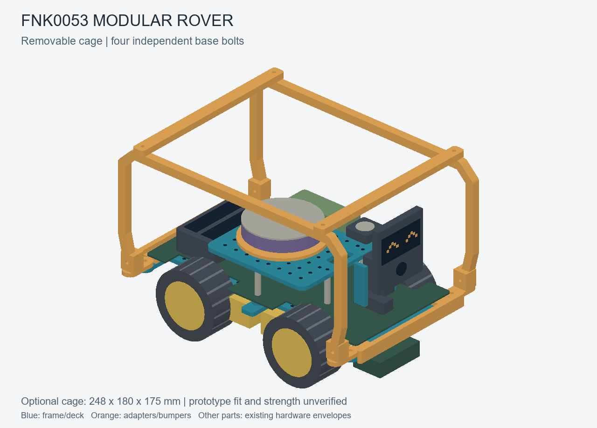

# Removable cage prototype

Two side hoops, two roof crossbars and four mounting feet form a bolt-on exoskeleton for revision B. Remove four dedicated base bolts to lift off the assembled cage. The bumper and accessory-deck fasteners are independent.



## Printable parts

All dimensions are nominal millimetres. These are experimental parts, with no physical fit or strength test yet.

| Part | Quantity | Print envelope |
| --- | ---: | --- |
| [Side hoop](../experimental/cage/side-hoop-print-two.stl) | 2 | 248 × 117.7 × 8 |
| [Mounting foot](../experimental/cage/foot-print-four.stl) | 4 | 14 × 33 × 20 |
| [Roof crossbar](../experimental/cage/roof-crossbar-print-two.stl) | 2 | 12 × 180 × 6 |
| [Carrier with cage mounts](../experimental/cage/frame-with-cage-mounts.stl) | 1 | 244 × 142 × 10.7 |

Use the cage-ready carrier in place of the original revision B frame. It adds four integrated mounting pads; the original frame does not have these holes. The hoops are exported flat for printing. Their 248 mm length leaves little room for a brim on the P1S; check the sliced placement before printing. Use millimetres and 100% scale.

The assembled cage is 248 mm long and 180 mm wide, with its top 175 mm above the ground. Bumpers bring the rover's total length to approximately 254 mm. Tire spacing stays unchanged; the cage extends beyond the tires.

## Assembly and removal

1. Fit four feet onto the carrier pads, at X = ±114 and Y = ±64 relative to the board centre. Use one vertical M3 bolt at each foot. The upright ears face outward.
2. Join each side hoop to its two feet with horizontal M3 bolts: four joints total.
3. Fit the two crossbars over the hoops at X = ±100. Use four vertical M3 bolts through the bar ends and hoop rails.
4. To remove the complete cage, undo only the four foot-to-carrier bolts and lift it clear. Check cable routing before lifting.

There are twelve bolted joints in total: four base, four hoop-to-foot and four roof joints. Holes have nominal 3.4 mm M3 clearance. Use nuts and washers, and tighten gently against PLA. Screw lengths, tool access, nut retention and printed hole fit need checking on the actual parts. Hardware is not depicted in the preview. Removal requires tools; this version is not a snap latch.

## Checks and remaining work

The exported meshes pass watertightness, winding, positive-volume, connectivity and print-envelope checks. Static intersections against the simplified hardware envelopes were checked, with none detected. The roof-crossbar underside is at Z = 169 mm; the current head envelope reaches 148.2 mm, giving 20.8 mm nominal static overhead clearance. This does not establish clearance throughout head movement.

Head sweep, ribbon-cable movement, camera view, microphone acoustics and complete assembly access remain unverified. The open roof leaves the central audio area accessible. No impact, drop, rollover or structural load test has been performed; this is a protective-cage concept without a rollover rating. Do not use the cage as a carrying handle until its strength and attachment have been tested.

## Rebuild and edit

After installing the repository requirements:

```sh
python scripts/build_mechanics.py
python build_preview.py
python scripts/build_cage.py
python build_preview.py
python scripts/export_preview.py
python scripts/render_concept.py
```

The first preview build supplies the hardware envelopes used by the cage checks. See [validation results](../experimental/cage/validation.json), [Python geometry](../cage_layout.py) and [OpenSCAD source](../removable-cage.scad). In `revision-b.scad`, `show_cage` controls assembly visibility; selectable parts are `cage_side`, `cage_foot`, `cage_roof` and `cage_frame`. OpenSCAD sources have not been compiled with an OpenSCAD executable in this environment.
